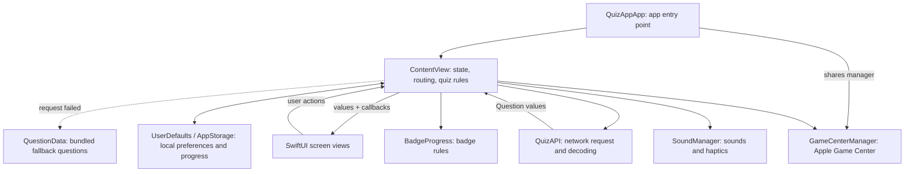

# How Cleverr Mind Is Built

An architecture guide for a Swift programmer who is new to iOS. This describes the current code in this project, rather than an idealized version of it.

## The short version

Cleverr Mind is a native iPhone and iPad app written in SwiftUI. SwiftUI describes what each screen should look like. `ContentView` keeps the current quiz and screen state, asks other parts of the app for data or platform features, and passes values and actions into smaller screen views.

There is no server owned by this app. Questions normally come from Open Trivia DB over the internet; bundled questions are a backup. Player progress and preferences are stored on the device with Apple's `UserDefaults` system. Game Center is an optional Apple service for player identity and leaderboard scores.

## Architecture at a glance



Think of `ContentView` as the game host. Screen views are the display and controls. The API and platform managers are helpers that handle jobs requiring the network or iOS services.

## What happens when you play

```mermaid
sequenceDiagram
    actor Player
    participant Screen as SwiftUI screen
    participant Main as ContentView
    participant API as QuizAPI / Open Trivia DB
    participant Local as Bundled questions
    participant Store as UserDefaults

    Player->>Screen: Tap Play, category, difficulty
    Screen->>Main: Call a passed-in action closure
    Main->>Main: Set state; SwiftUI shows next screen
    Main->>API: Request 10 multiple-choice questions
    API-->>Main: Decoded and shuffled Question values
    alt Request fails
        Main->>Local: Choose this category's questions
        Local-->>Main: Question values
    end
    Main-->>Screen: Pass current question and state
    Player->>Screen: Choose an answer
    Screen->>Main: Call onAnswer(index)
    Main->>Main: Check answer, update score and feedback state
    Main-->>Screen: New state; SwiftUI redraws affected UI
    Player->>Screen: Finish the last question
    Screen->>Main: Advance action
    Main->>Main: Update local stats and badge progress
    Main->>Store: Persist progress
    Main-->>Screen: Show results
```

### In plain language

1. The player taps a button. A screen calls a closure such as `onPlay` or `onAnswer` that `ContentView` supplied.
2. `ContentView` changes state. For example, it marks loading as true or changes the active screen.
3. SwiftUI notices state changes and recomputes the relevant view descriptions. It updates the display; you usually do not manually tell it to redraw.
4. When a round starts, `fetchQuestions` calls the trivia API with `URLSession`. The response is decoded from JSON, cleaned up, and its options are shuffled.
5. If no usable API result arrives, `ContentView` uses that category's built-in question set. A failed service request does not necessarily mean the phone is offline.
6. At round completion, `finishQuiz()` updates local counters, streak, points, and badges, and asks Game Center to submit the score when appropriate.

## The iOS and SwiftUI ideas in this app

### App entry point and view tree

`QuizAppApp` is marked `@main`, so iOS starts the app there. It creates the shared `GameCenterManager` and places it in the SwiftUI environment. Its `WindowGroup` hosts `ContentView`. A SwiftUI app is a tree of views: parent views build child views, which build their own children.

### `View` is a description, not a screen object

Types such as `StartScreenView` and `QuizRoundView` conform to SwiftUI's `View` protocol. Their `body` says what should appear for the current values. SwiftUI can recreate these value-like view descriptions often; it preserves state using its identity system. Avoid thinking of a `View` as a long-lived UIKit view object.

### State drives the interface

`@State` marks short-lived UI/game state owned by `ContentView`, such as `score`, `currentIndex`, and `isLoading`. When one changes, the screen can update. Here screen routing is also state driven: `activeScreen` checks flags such as `gameStarted` and `quizFinished` to decide which screen to show.

`@AppStorage` reads and writes a named value in `UserDefaults`. It is used for preferences and long-lived values such as total points and streak. `@StateObject` creates and owns an observable reference object (`TutorialManager` here). `@EnvironmentObject` reads an observable object provided higher in the view tree (`GameCenterManager`). These wrappers are SwiftUI property wrappers: syntax that connects a property to SwiftUI's update and storage behavior.

### Parent owns decisions; child screens report actions

`ContentView` passes ordinary values into screen views (question text, colors, score) and closures back out (answer, go home, choose category). A closure is a function value. This pattern keeps the screen view focused on display and input while the parent decides what an action means. It is sometimes called “lifting state up”: put shared decision-making state in a common parent.

### Models describe data

`Question` stores question text, answer options, and the correct answer. `QuestionSet` groups questions under a category. These structs are plain Swift data types; they do not draw UI or make network calls. `TriviaResponse` and `TriviaQuestion` mirror the JSON shape returned by the service and use `Codable` so `JSONDecoder` can turn JSON into Swift values.

### Network work is asynchronous

An internet request takes an unknown amount of time and may fail. `URLSession` runs the request asynchronously; a completion closure receives the result later. `ContentView` shows loading while it waits. The API helper also spaces requests and retries rate-limit responses. Its callback is dispatched to the main queue before it changes SwiftUI state. The main thread is where UI-related state updates should happen.

### Device storage is not a database

`UserDefaults` is a small on-device preferences store. `@AppStorage` is SwiftUI's convenient connection to it. This is suitable for simple settings and counters, but it is not a relational database, account sync, or backup system. Some dictionaries are encoded as JSON (`setCounts`); several other per-category dictionaries are manually packed into strings with `|` and `:` separators. Resetting or deleting the app may remove this local progress. Game Center is separate and does not automatically sync these statistics.

### iOS lifecycle and platform services

`scenePhase` tells the app whether its window is active or in the background. This app uses it to restart entrance animations and leave an active quiz when backgrounded. `GameCenterManager` wraps Apple's GameKit leaderboard calls. `SoundManager` wraps system sounds and haptics. These are integrations with iOS services, not app-owned servers.

## Where to look in the project

| File | Responsibility |
|---|---|
| [`QuizApp/QuizAppApp.swift`](QuizApp/QuizAppApp.swift) | Application entry point and shared Game Center object |
| [`QuizApp/Views/ContentView.swift`](QuizApp/Views/ContentView.swift) | Screen routing, quiz state/actions, lifecycle, persistence, and coordination |
| [`QuizApp/Views/QuizScreens.swift`](QuizApp/Views/QuizScreens.swift) | Main loading, start, category, difficulty, quiz, and results screens |
| `QuizApp/Views/SettingsView.swift`, `HelpView.swift`, `BadgesView.swift`, `CategoryStatsView.swift`, `ThemePickerView.swift` | Settings and supporting sheets |
| [`QuizApp/Models/Question.swift`](QuizApp/Models/Question.swift) | Core question data types and HTML text cleanup |
| [`QuizApp/Models/QuizAPI.swift`](QuizApp/Models/QuizAPI.swift) | Trivia API request, JSON decoding, retry/rate limiting, answer shuffle |
| [`QuizApp/Models/QuestionData.swift`](QuizApp/Models/QuestionData.swift) | Bundled fallback question sets |
| [`QuizApp/Models/Badges.swift`](QuizApp/Models/Badges.swift) | Badge definitions and rules that evaluate progress |
| [`QuizApp/Models/GameCenterManager.swift`](QuizApp/Models/GameCenterManager.swift) | Game Center authentication state, score submission, leaderboard display |
| `QuizApp/Models/TutorialManager.swift` | Tutorial step state machine |
| `QuizApp/Models/SoundManager.swift`, `AppColors.swift`, `CategoryStatRow.swift` | Sound/haptics, theme conversion, and category-stat display data |
| `QuizApp/Views/SpotlightOverlay.swift`, `ConfettiEffect.swift`, `ShimmerEffect.swift` | Reusable tutorial overlay and visual effects |

## Architecture strengths and current limitations

The code already separates question data, API work, badge rules, platform integrations, and reusable screen layouts. The screens receive values and callbacks, which makes their role easier to understand. The app also has a useful offline fallback and does not confuse every server error with lost internet access.

The main tradeoff is that `ContentView` has many jobs: it routes screens, holds most game state, runs quiz rules, manages the timer, and reads/writes statistics. That is manageable for a small app, but as features grow it becomes harder to change one concern without affecting another. A common next step is to move quiz rules/state into a dedicated observable `QuizViewModel`, and move storage behind a small `ProgressStore` type. The UI can then observe the view model, while the model coordinates a question service and progress store. This is a learning direction, not a claim that the project already has those layers.

There are also concrete implementation details worth knowing:

- The source comments say question sets have ten questions, and the API asks for ten, but `questionCount` comes from the bundled set. The quiz currently relies on those counts matching.
- Several dictionaries are stored using delimiter-separated strings. A category name containing `:` or `|` could make that format difficult to decode; JSON encoding is safer for structured data.
- `GameCenterManager` has an authentication method that can present Apple's sign-in UI, but the current `ContentView.authenticateGameCenter()` assigns an empty handler directly. The README notes that authentication flow needs to be connected for reliable score submission.
- `ContentView` stores the timer as a `Timer?`; lifecycle changes and exits must invalidate it so it does not continue counting when a round is no longer active.
- The round completion code records some stats only for online rounds and streak/category play counts for offline rounds. That is a product rule implemented in `finishQuiz()`, not behavior supplied automatically by SwiftUI.

## A glossary

- **Architecture:** how responsibilities and data are organized across the app.
- **State:** values that describe what the app is doing right now.
- **Persistence:** saving values so they survive after the current screen or app session.
- **Model:** a Swift type that represents information, such as a question.
- **View:** a SwiftUI description of user interface.
- **Callback / closure:** a function passed to another part of the program to be called later.
- **API:** a defined way for one program to request data or actions from another. Here, the app requests trivia questions from Open Trivia DB.
- **Decode:** turn a structured format such as JSON into Swift values.
- **Lifecycle:** stages such as active and background that an iOS app moves through.
- **Observable object:** a reference object that publishes changes so SwiftUI can refresh views that depend on it.

## A good reading path

Start with `QuizAppApp.swift`, then read `ContentView.swift` from its state properties through `activeScreen`, `body`, quiz actions, and persistence helpers. Next compare one child screen in `QuizScreens.swift` with the values and closures passed to it. Then follow `startSet` into `QuizAPI.swift` and `Question.swift`, and finish with `finishQuiz` and `Badges.swift` to see how results become saved progress.
